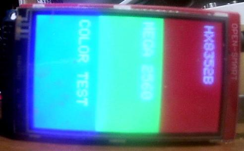

# OPEN-SMART HX8352B + Arduino Mega 2560

**Hardware-verified working solution, preserved 28 November 2026 (Europe/Kyiv).**
The owner reports attempts to revive this display since 2022.
This repository preserves the successful experiment, not a redesigned driver.

[Русская документация](README.ru.md) · [Reproduce](docs/REPRODUCE.md) · [Pinout](docs/PINOUT.md) · [Diagnostics](docs/DIAGNOSTICS.md)

**Clean GitHub-clone rebuild: byte-identical HEX.** [Validation report](docs/VALIDATION.md).



## The four essential settings

| File | Setting |
|---|---|
| `libraries/MCUFRIEND_kbv/utility/mcufriend_shield.h` | `#define USE_SPECIAL` |
| `libraries/MCUFRIEND_kbv/utility/mcufriend_special.h` | `#define USE_OPENSMART_SHIELD_PINOUT_MEGA` |
| `libraries/MCUFRIEND_kbv/MCUFRIEND_kbv.cpp` | `#define SUPPORT_8352B` |
| `color_test/color_test.ino` | **`tft.begin(0x0065);`** |

**HX8352B does NOT mean `begin(0x8352)` in this library.**
That call was tested and produced a white screen.
The controller returned `0x0065`; the library's HX8352-B switch case is `0x0065`.
OPEN-SMART uses a different bus pinout from standard TFT shields.
An illuminated backlight does not prove successful controller initialization.
No physical wiring change was needed. Red, green and blue bars and text were verified through the PC webcam.

## Preserve / restore

- Original, unrefactored sketch and complete configured library are committed.
- Adafruit GFX **1.12.6** and BusIO **1.17.4** are vendored, not fetched as “latest”.
- CLI **1.5.1**, AVR Core **1.8.8**, GCC **7.3.0** (Arduino toolchain **7.3.0-atmel3.6.1-arduino7**).
- FQBN `arduino:avr:mega`; tested Windows port `COM3`.
- `firmware/color_test.hex` is the actual uploaded, working application firmware.
- Release assets preserve the environment; see [REPRODUCE](docs/REPRODUCE.md) for extraction/verification.
- `python scripts/verify.py` verifies committed file hashes.
- `powershell -ExecutionPolicy Bypass -File scripts/build.ps1` builds in isolation; it **does not upload**.
- Upload is a separate explicit opt-in: `scripts/upload.ps1 -Port COM3 -ConfirmUpload`.

Firmware SHA-256:
```
5c606f44398f1e92de6aa939ce354e2dd6326a18caf083ca3bc50c6788f7d964
```

## Scope and limitations

Portrait `setRotation(0)` is the verified setting (the display is physically sideways in the photo).
Touch, SD, temperature sensing, other orientations and other boards were not tested.
Linux script is provided but not validated on a Linux host.
Old Flash is retained locally, excluded from GitHub because it contains previous network-program data.
The original EEPROM is erased (`0xFF`) and safe to archive.
Some original session photographs are not available as local files; no missing image is fabricated.
See [evidence provenance](evidence/README.md), [environment](docs/ENVIRONMENT.md), and [sources](docs/REFERENCES.md).

Third-party code retains its original licenses. See [THIRD_PARTY_NOTICES](THIRD_PARTY_NOTICES.md).
