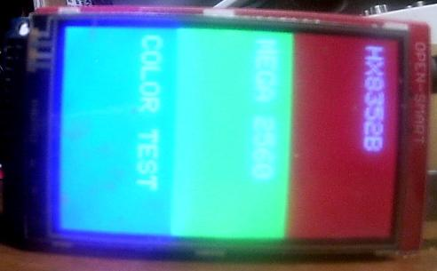

# OPEN-SMART HX8352B + Arduino Mega 2560

Решение проблемы белого экрана OPEN-SMART HX8352B TFT LCD Shield (240 × 400, параллельная шина 8 бит) на Arduino Mega 2560 с MCUFRIEND_kbv 3.0.0-Release.

**Проверка чистого клона GitHub: HEX совпал побайтово.** [Отчёт](docs/VALIDATION.md).



## Что устранило белый экран

Нужны одновременно четыре настройки:

```cpp
// utility/mcufriend_shield.h
#define USE_SPECIAL
// utility/mcufriend_special.h
#define USE_OPENSMART_SHIELD_PINOUT_MEGA
// MCUFRIEND_kbv.cpp
#define SUPPORT_8352B
// color_test.ino
tft.begin(0x0065);
```

**Название HX8352B не означает, что в этой версии библиотеки нужно передавать `0x8352`.**
Эксперимент с `tft.begin(0x8352)` дал белый экран. Считанный ID — `0x0065`;
этому значению соответствует ветка HX8352-B в исходниках MCUFRIEND_kbv.

У OPEN-SMART другая распиновка, нежели у обычного TFT Shield. Светящаяся подсветка
не доказывает, что контроллер инициализирован. Подключение оборудования физически
не менялось. Успех подтверждён через веб-камеру: цветные полосы и читаемый текст.

## Состав проекта

- Тестовый скетч `color_test/color_test.ino`.
- Полная настроенная MCUFRIEND_kbv **3.0.0-Release** и патч из трёх строк.
- Полные Adafruit GFX **1.12.6** и Adafruit BusIO **1.17.4** с лицензиями.
- HEX, который действительно был загружен и проверен на экране.
- Контрольные суммы, версии инструментов, таблица распиновки, история диагностики.
- Архив окружения в релизе и инструкции изолированной сборки.

CLI **1.5.1**, AVR Core **1.8.8**, GCC **7.3.0**,
toolchain **7.3.0-atmel3.6.1-arduino7**, FQBN **`arduino:avr:mega`**, порт теста **COM3**.

## Восстановление

1. Клонировать репозиторий и скачать архив окружения из релиза `v1.0.0`.
2. Следовать [docs/REPRODUCE.md](docs/REPRODUCE.md).
3. Проверить файлы: `python scripts/verify.py`.
4. Собрать: `powershell -ExecutionPolicy Bypass -File scripts/build.ps1`.
5. Только если нужна прошивка: `scripts/upload.ps1 -Port COM3 -ConfirmUpload`.

Сборка не прошивает Arduino и не использует глобально изменённые библиотеки.
SHA-256 рабочего HEX:
```
5c606f44398f1e92de6aa939ce354e2dd6326a18caf083ca3bc50c6788f7d964
```

## Документация

**[Полное техническое описание на русском](docs/TECHNICAL.ru.md)** —
оборудование, исходники, распиновка, окружение, восстановление и ограничения.

- [Оборудование](docs/HARDWARE.md)
- [Точная распиновка](docs/PINOUT.md)
- [История диагностики](docs/DIAGNOSTICS.md)
- [Воспроизведение](docs/REPRODUCE.md)
- [Окружение](docs/ENVIRONMENT.md)
- [Проверенные источники](docs/REFERENCES.md)
- [Поиск неисправностей](docs/TROUBLESHOOTING.md)

## Ограничения и безопасность

Проверены только данная Mega, данный шилд и `setRotation(0)`.
Сенсор, SD, датчик температуры и остальные ориентации не тестировались.
Linux-скрипт не проверялся на Linux.

Для автоматизированной диагностики: [AGENTS.md](AGENTS.md).

Сторонние лицензии сохранены; см. [THIRD_PARTY_NOTICES.md](THIRD_PARTY_NOTICES.md).
